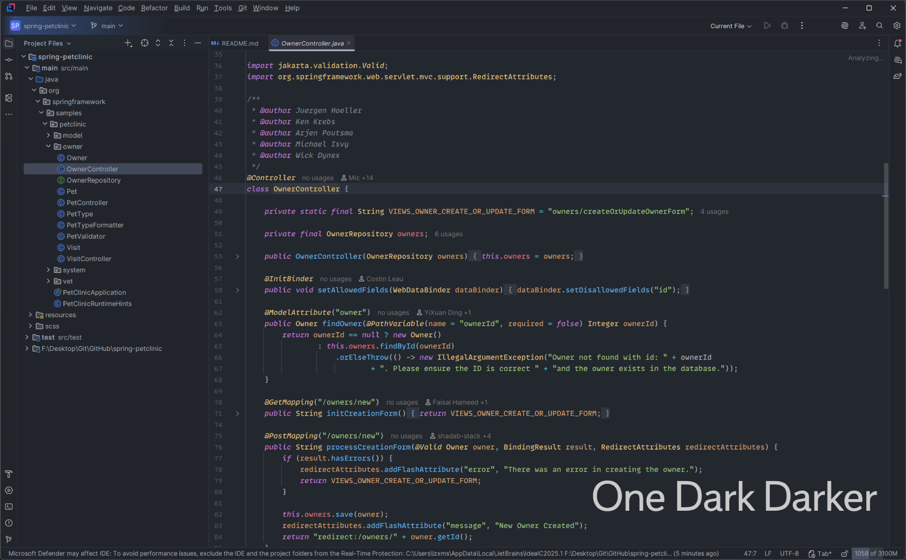
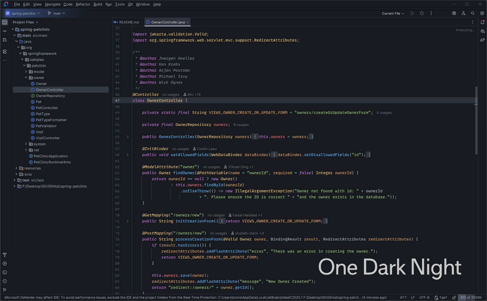

# One Dark Darker theme for JetBrains.

[](https://plugins.jetbrains.com/plugin/20140-one-dark-darker)
[](https://plugins.jetbrains.com/plugin/20140-one-dark-darker)

## Darker Vairant


## Night Variant



# Build

```shellscript
pip install PyYaml
python generator.py -y ./colors/ThemeData.yaml -i ./theme/ -o output
```
